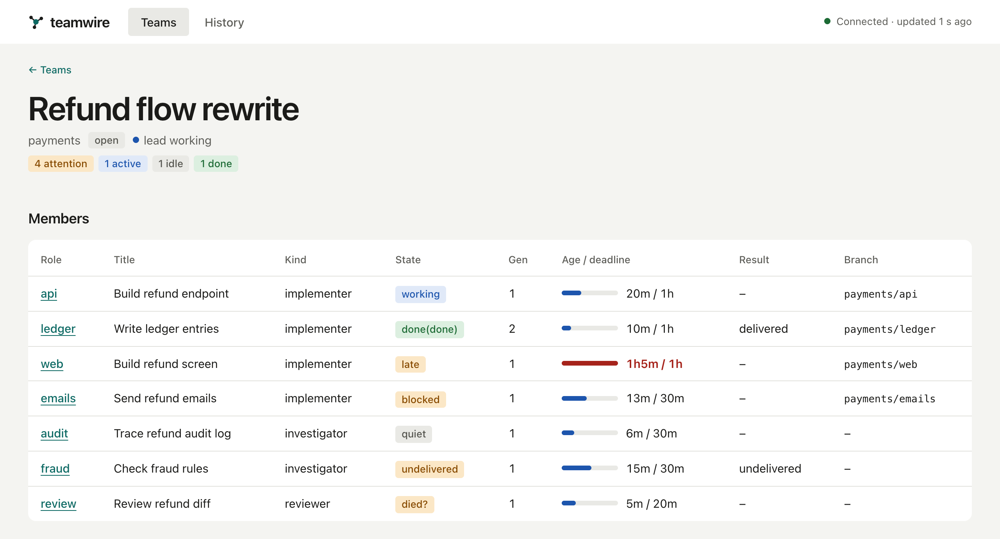
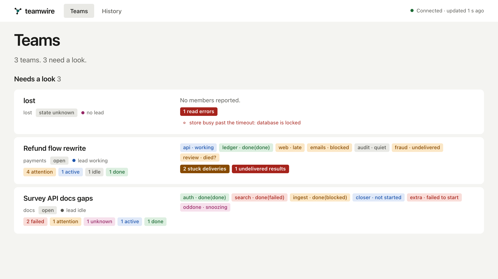

<div align="center">

<picture>
  <source media="(prefers-color-scheme: dark)" srcset="docs/assets/teamwire-mark-on-dark.svg">
  
</picture>

# teamwire

**Run a team of coding agents from one lead agent, and get every result back with no human watching.**


[Features](#features) ·
[How it works](#how-it-works) ·
[Install](#install) ·
[Quick start](#quick-start) ·
[Dashboard](#dashboard) ·
[Docs](#documentation)

<picture>
  <source media="(prefers-color-scheme: dark)" srcset="docs/assets/screenshots/team-dark.png">
  
</picture>

</div>

## What is teamwire?

teamwire is a single Rust binary for running agent teams. A lead agent, such
as a Claude Code session, uses it to do five things:

- start members, each in its own terminal tab
- pass checked messages between them
- collect each member's result
- check the work
- close the team down safely

Parallel agents fail in ways nobody sees. A member crashes mid-turn, a result
is typed into the wrong pane, a "tests pass" claim is false, or a teardown
deletes work nobody committed. teamwire stores every message and every result
in SQLite before it tries to deliver it. When a delivery fails, teamwire
reports the failure instead of dropping it.

## Features

- **One command starts a team.** `teamwire launch` reads a JSON spec. It gives
  each member a role, a brief and its own git worktree, then opens the member
  in a tab beside the lead.
- **Members report by themselves.** A member records `teamwire done`, and a
  Stop hook types one line into the lead's pane with the path to the full
  result. The lead never polls.
- **Every failure gets a line.** `teamwire watch` prints one line when a
  member dies, stalls at a dialog, runs past its deadline or goes quiet. It
  also prints one line when the whole team completes.
- **Messages are checked and logged.** `teamwire send` checks the sender, the
  recipient and the message type before it stores the message. Reviewers and
  closers cannot be messaged by other members, so their view stays fresh.
- **Teams can talk to each other.** An agent addresses another team's member as
  `role@team`. Messages from another team arrive marked as information, never
  as instructions.
- **Claims get checked.** `teamwire verify` runs each member's check itself. It
  also flags edits outside the files the member owns, plus deleted, skipped or
  weakened tests.
- **Teardown happens in a safe order.** `teamwire close` refuses while a member
  is busy or has uncommitted work. It archives the team and checks the archive
  before it removes anything.
- **Closed sessions come back.** `teamwire reopen` resumes the lead and every
  member whose session is gone.
- **A full context gets a fresh session.** `teamwire handoff` gives a member a new
  session in the same seat when its context runs high.
- **Team shapes come ready-made.** `teamwire preset` prints a tested spec for
  five common team shapes, plus a closer that checks a finished team.
- **Metrics stay on your machine.** `teamwire metrics` reads each team's
  events locally. `teamwire metrics export` sends them to an OpenTelemetry
  endpoint.
- **A run can go on while you are away.** `/teamwire:afk <task>` starts a team
  that researches, plans, builds, verifies and writes one report with nobody
  to answer it. The result is a local branch. Nothing is pushed.
- **A dashboard comes with it.** A read-only web dashboard in [`ui/`](ui/)
  shows every team, its members, its messages and closed teams' archives.

## How it works

```
lead (Claude Code session)
  │  teamwire launch ── setup ── brief ──►  member in its own tab
  │                                               │
  │                                    member runs `teamwire done`
  │                                               │
  │                                      Stop hook delivers the result
  │  ◄──── one line typed into the lead's pane ───┘
  │
  ├── teamwire watch     deaths, dialogs, overdue members, team complete
  ├── teamwire send      a checked, stored message to a member or another team
  ├── teamwire status    "where are we?" in one screen
  ├── teamwire verify    run each member's check and the diff rules
  └── teamwire close     archive, remove worktrees, close tabs
```

The lead calls teamwire through the CLI or through the MCP tools in the
teamwire plugin. A member gets its own MCP tools, and none of them can run
the commands that start, close or reopen a team. The member's identity comes
from a per-member token, so no member can send as another member or as the
lead.

Each team has one SQLite database under `$TEAMWIRE_HOME`. teamwire also
writes every message body and every result as a Markdown file beside the
database, so a person can read them.

## Supported platforms

| Part | Supported |
| --- | --- |
| Agent harness | Claude Code, Codex CLI and pi, each for members and for the lead. A Codex or pi lead cannot run AFK mode. |
| Terminal host | [herdr](https://herdr.dev) and tmux. In tmux, teamwire finds the lead through the process tree and asks Claude Code whether a member is working. |
| Operating system | macOS. Linux works without the sleep hold that keeps the machine awake during a run. |

## Requirements

- Rust 1.94.1. The `rust-toolchain.toml` file pins it, so `rustup` installs it
  for you.
- git
- Claude Code, with `claude` on `PATH`. Codex CLI is optional: install it to use `codex` as a harness. pi is optional too; under herdr it needs `herdr integration install pi`.
- herdr or tmux. The lead session must run in a herdr pane or a tmux window
  of its own. With herdr, its session hook must be in your Claude Code
  settings.
- [Bun](https://bun.sh), only for the dashboard

## Install

Build from a clone:

```bash
git clone https://github.com/kryptonian41/teamwire.git
cd teamwire
cargo install --locked --path crates/teamwire-cli
```

Or install a tagged release straight from git:

```bash
cargo install --locked --git https://github.com/kryptonian41/teamwire.git --tag v0.20.0 teamwire-cli
```

Then check the machine and install the Claude Code plugin:

```bash
teamwire doctor     # read-only checks; one FAIL until the plugin is installed
teamwire install    # registers the teamwire plugin with `claude plugin`
```

`teamwire install` writes one plugin to `$TEAMWIRE_HOME/claude-plugin/`. The
plugin holds the lead's skill (`/teamwire:teamwire`), the lead's MCP server
and the lead's Stop and tool hooks. Start a new Claude Code session afterwards, because
an open session does not load a new plugin. Run `teamwire install` again
after every `cargo install`. `teamwire uninstall` removes the plugin.
`teamwire install --harness codex` installs the Codex plugin from
`$TEAMWIRE_HOME/codex-plugin/`. `teamwire install --harness pi` writes a pi
package to `$TEAMWIRE_HOME/pi-package/` and adds it with `pi install`. In a
pi lead, the watch runs through the package's `teamwire_watch` tool, and each
watch line reaches the lead as a message.

Before you rely on teamwire, run the live checks in
[docs/test-strategy.md](docs/test-strategy.md), section 6. They prove that
your installed Claude Code and terminal host behave the way teamwire expects.

## Quick start

Run these from the lead's Claude Code session, inside a herdr pane or a tmux
window. The easiest way is to ask the lead to use the `/teamwire:teamwire`
skill, which holds the whole procedure. By hand:

```bash
teamwire preset                    # list the team shapes
teamwire preset survey             # print one shape's rules and a spec skeleton
# save the spec as team.json and fill in every CHANGEME and /abs/path value
teamwire launch --dry-run --spec team.json
teamwire launch --spec team.json
teamwire watch <team>              # leave it running in the background
```

teamwire types each member's result into the lead's pane when the member
finishes. Then:

```bash
teamwire status <team>             # members, messages and results
teamwire verify <team>             # run each member's check
teamwire close <team> --dry-run
teamwire close <team>
```

A minimal spec with one implementer looks like this:

```json
{
  "team": "refunds",
  "title": "Build the refund endpoint",
  "setup": "./scripts/setup-worktree.sh \"$1\"",
  "children": [
    {
      "role": "api",
      "title": "Build refund endpoint",
      "kind": "implementer",
      "mode": "worktree",
      "task_class": "contained_feature",
      "repo": "/abs/path/to/repo",
      "branch": "refunds/api",
      "base": "main",
      "check": "cargo test -p refunds --locked",
      "owns": ["crates/refunds/"],
      "task_file": "/abs/path/to/api-brief.md"
    }
  ]
}
```

The member runs on the lead's harness, because the spec names no `harness`.
Its `task_class` says how hard its task is to reason about. To choose its
model, add `model` and `effort` from what `teamwire models` lists for that
harness. Without them, the member runs on its harness's defaults.

## Team shapes

`teamwire preset <name>` prints the rules and a spec skeleton for each shape.
The specs also live in [examples/presets/](examples/presets/).

| Preset | Use it when |
| --- | --- |
| `parallel-tickets` | Several tickets touch different modules. No integration needed. |
| `dependent-tickets` | Tickets block each other. Members start in waves, and the integrator merges blockers first. |
| `survey` | You need a read-only investigation across several areas. |
| `implement-then-review` | One implementer builds, then one fresh reviewer reads the finished diff. |
| `contract-split` | One feature must be split across implementers. Use it only as a last resort. |
| `integrator` | A finished team's branches must join into one. One implementer merges them in the plan's order and runs the full gate. It is a final step, not a shape. |
| `closer` | A finished team that wrote code needs one agent to check every claim and write one report. It is a final step, not a shape. |

Most coding work should not be a team. Parallel agents cost far more tokens
than one chat, so a team pays off only when its parts are truly independent.

## Commands

| Command | What it does |
| --- | --- |
| `teamwire launch` | Validate a team spec, then start its members. `--add` adds members to a running team. |
| `teamwire watch` | Print one line when something needs the lead, until the team completes. |
| `teamwire status` | Show every team, or one team's members, messages and results. Reads only. |
| `teamwire send` / `resend` | Send one checked message, or retry one that did not arrive. |
| `teamwire received` | Record that you read a result the hook could not type into your pane. |
| `teamwire log` | List every message with its delivery state. |
| `teamwire verify` | Run each member's check and the diff rules, and print a verdict per member. |
| `teamwire close` | Close the team, or remove one member, in a fixed safe order. |
| `teamwire reopen` | Resume the lead and the members of a team whose sessions are gone. |
| `teamwire teams` / `members` | List every team on this machine, or one team's roster. |
| `teamwire lead --adopt` | Make a new session the lead of an existing team. |
| `teamwire preset` | List the team shapes, or print one. |
| `teamwire pr-watch` | Watch GitHub pull-request checks until every pull request is done. |
| `teamwire metrics` / `export` | Local metrics from the event rows, or every record of a team as JSON lines. |
| `teamwire afk start` | Create the team of an AFK run and take the sleep hold. The `/teamwire:afk` skill runs it. |
| `teamwire doctor` | Run read-only checks of the state, the disk and the tools teamwire needs. |
| `teamwire install` / `uninstall` | Install or remove the teamwire plugin for Claude Code, and for Codex with `--harness codex`. |
| `teamwire done`, `inbox`, `ack` | Members only: record a result, read messages, mark messages read. |

[docs/api/cli.md](docs/api/cli.md) lists every flag, output and exit code.

## AFK runs

Type `/teamwire:afk <task>` in a Claude Code session started with
`claude --permission-mode bypassPermissions`, then leave. The skill checks the
mode, runs `teamwire afk start --team NAME --title TITLE --task FILE
[--budget 8h]`, and leads one team through research, a plan, a plan review,
the build, a review of each branch, a closer and a reporter. The lead never
waits for you. It decides each open question, logs it in
`teams/<team>/afk/decisions.md`, and carries on. The Stop hook holds the lead
once when it would stop with nothing to wake it.

The run never pushes, opens a pull request, or merges into your base branch.
It ends with `teamwire close`, which refuses until `afk/REPORT.md` has its
eight headings. The result is a local branch `afk/<team>`, and the report is
in the archive. Past the budget (default 8 hours), launch refuses new
implementers and lets everything else finish. Keep the lid open and the
machine on power, because a closed lid still sleeps a Mac. ADR 0025 has the
design.

## Dashboard

<picture>
  <source media="(prefers-color-scheme: dark)" srcset="docs/assets/screenshots/overview-dark.png">
  
</picture>

The dashboard in [`ui/`](ui/) is a Bun and React app that only reads. It
runs `teamwire ... --json` on a timer and serves the page on `127.0.0.1`. It
never runs `watch`, `send` or any command that changes a team.

```bash
cd ui
bun install --frozen-lockfile
bun run start      # prints a link that carries the access token; open it
```

Add `?mock=1` to the page's URL to see invented sample teams instead of your
own. [ui/AGENTS.md](ui/AGENTS.md) has the dashboard's rules and commands.

## Configuration

| Setting | Default | What it does |
| --- | --- | --- |
| `TEAMWIRE_HOME` | `~/.teamwire` | Where every team's state lives. `--home <DIR>` overrides it on any command. |
| `host` in the spec | detected | The terminal host. teamwire picks herdr when `HERDR_ENV=1`, and tmux when `TMUX` is set. |
| `harness` in the spec | the lead's harness | The agent program each member runs (`claude-code`, `codex`, or `pi` for a member). A member can name its own `harness`. |
| `plugins` in the spec | the user's own switches | Turns Claude Code plugins on or off for members. |

teamwire writes nothing under `~/.claude/` itself. Only `teamwire install`
and `teamwire uninstall` change a harness's setup, and they do it through
`claude plugin` and `codex plugin`. `teamwire install` also deletes the
skill file that a build before v0.3.0 put in `~/.claude/skills/teamwire/`, and
the `teamwire` MCP entry it put in `~/.claude.json` (through `claude mcp
remove`). It refuses to delete a skill file you edited, unless you pass
`--force`.

## Documentation

| Document | What it holds |
| --- | --- |
| [docs/ARCHITECTURE.md](docs/ARCHITECTURE.md) | The design: components, data model, message lifecycle, failure handling, adapters, security, installation |
| [docs/api/cli.md](docs/api/cli.md) | Every subcommand: its flags, output and exit codes |
| [docs/api/mcp.md](docs/api/mcp.md) | Every MCP tool: input, output, errors |
| [docs/api/core.md](docs/api/core.md) | The Rust types, traits and service functions |
| [docs/requirements.md](docs/requirements.md) | Every requirement with its source, and the invariants that come from real incidents |
| [docs/failure-modes.md](docs/failure-modes.md) | Each failure, how teamwire detects it, what it does, and the test that proves it |
| [docs/metrics.md](docs/metrics.md) | Events, metrics and trace spans |
| [docs/adr/](docs/adr/) | Decision records: the options, the choice, the consequences |
| [docs/test-strategy.md](docs/test-strategy.md) | Fakes, property, crash, fault-injection and end-to-end tests, and the live checks |
| [CONTEXT.md](CONTEXT.md) | The glossary that the docs, errors and commands share |
| [examples/](examples/) | Team presets, the lead's skill, and the lead's MCP config |

## Contributing

The workspace has one crate per concern under `crates/`. A crate depends only
on crates in lower layers, as listed in
[docs/conventions.md](docs/conventions.md), section 5. Read
[AGENTS.md](AGENTS.md) before you change anything. It lists the hard rules
and the program that enforces each one.

```bash
cargo test -p <crate> --locked     # while you work on one crate
scripts/gate.sh fast               # format, tidy and clippy
scripts/test-changed.sh            # test the changed crates and every crate that depends on them
scripts/gate.sh                    # the full gate: adds every test, rustdoc and the docs check
```

Tests never start a real Claude session or type into a real terminal pane.
They use the fake binaries in `tests/fakes/` and set `TEAMWIRE_HOME` to a
temporary directory.

## License

teamwire is licensed under either of the MIT license or the Apache License,
Version 2.0, at your option. `Cargo.toml` declares this as
`MIT OR Apache-2.0`.
